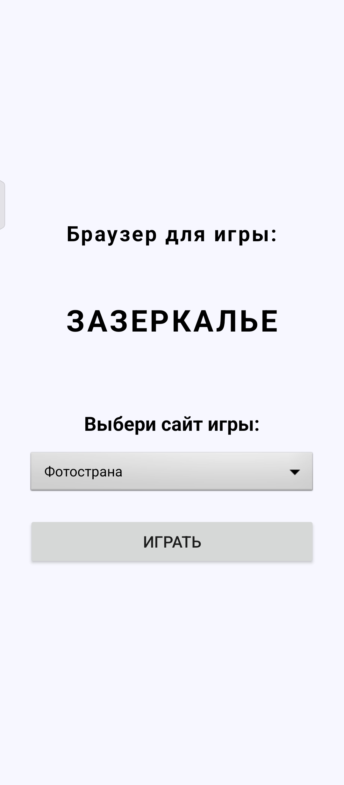
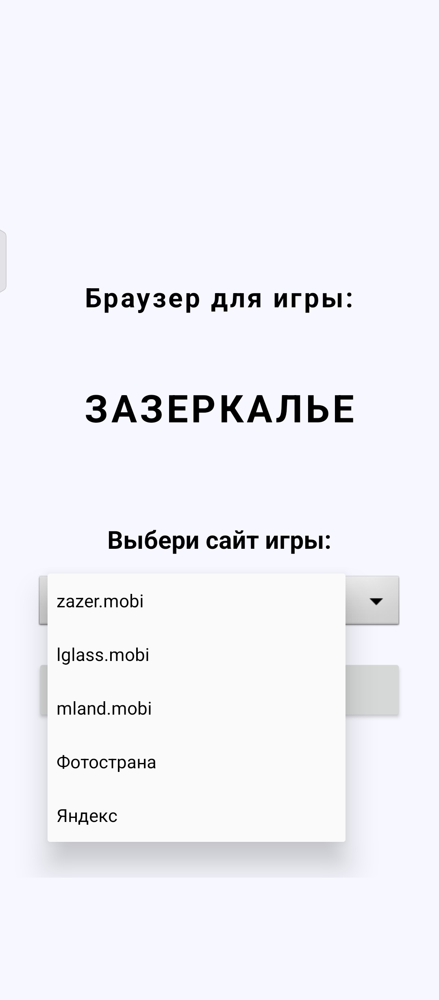
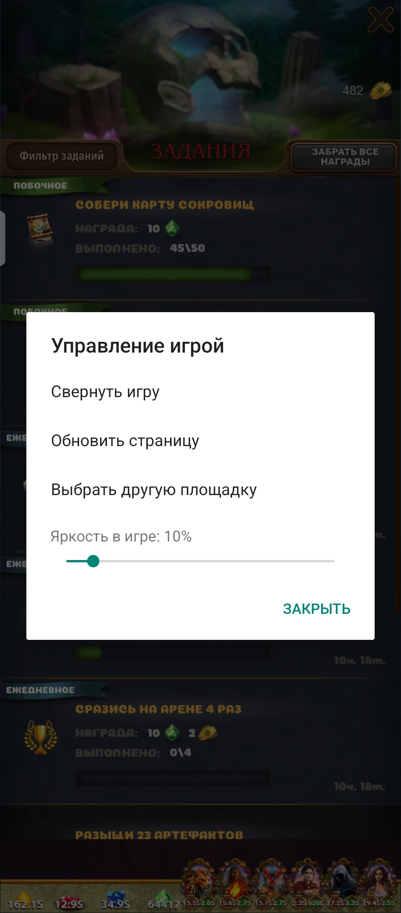
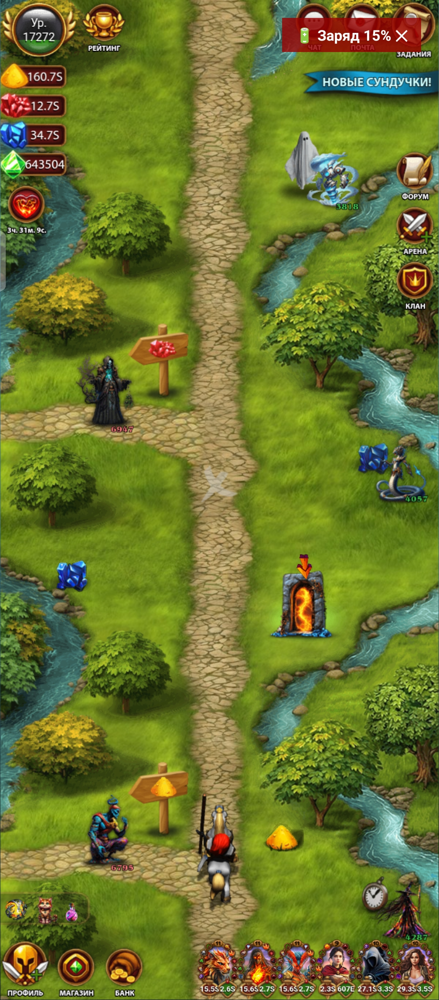

# 🪞 Браузер для игры «Зазеркалье»

Специализированный мобильный браузер для комфортной игры в **«Зазеркалье»** без отвлекающих элементов интерфейса.

---

## ✨ Возможности

* **Полное погружение (Fullscreen)** — игра открывается на весь экран без адресной строки и лишних панелей.
* **Свобода выбора** — возможность выбрать любую доступную игровую площадку прямо на стартовом экране.
* **Быстрое меню жестом** — удерживайте **два пальца** на экране (лучше внизу на уровне героя или ниже), чтобы вызвать панель управления:
  * 🏠 Вернуться на главный экран и сменить площадку
  * 🔄 Обновить игровую страницу
  * 🔽 Свернуть приложение
  * ☀️ Отрегулировать яркость экрана прямо во время игры
* **Контроль заряда батареи** — встроенный виджет заранее предупредит вас, когда заряд смартфона опустится **ниже 15%**, чтобы телефон не выключился.
* **Блокировка рекламы** - для Фотостраны и Яндекс

> [!TIP]
> **Если сверху осталась системная шторка или вырез камеры:** откройте настройки вашего смартфона, введите в поиске слово **«полноэкранный»** (или *«вырез»*) и разрешите приложению работать во весь экран.

---

## 📱 Скриншоты

  
  &nbsp;&nbsp;
  
  &nbsp;&nbsp;
  
  &nbsp;&nbsp;
  

